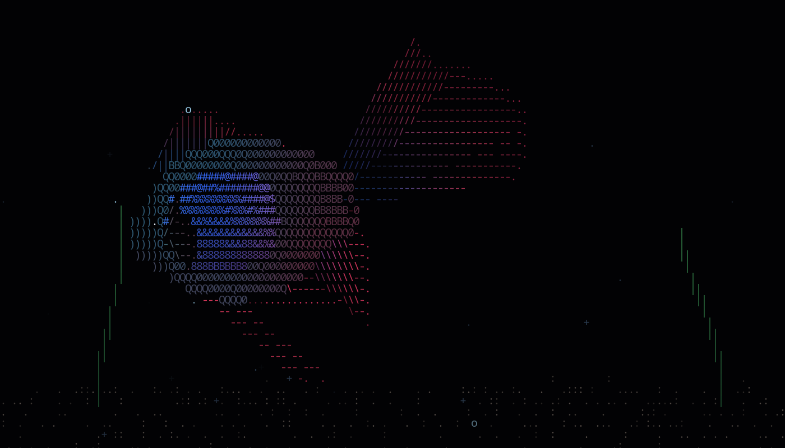

# ascii-aquarium

A procedural **3D ASCII aquarium** with a single betta fish, written in Rust.
The whole scene — fish, fins, bubbles, plants, floor — is computed from 3D
geometry every frame and rendered as colored ASCII glyphs on a sparse black
backdrop. No video file, no sprite art, no pixel framebuffer anywhere.



## How it renders

The renderer is a tiny 3D pipeline that outputs text:

- **Procedural 3D geometry** — the betta is sampled from parametric parts in
  a local model space: a deep, laterally-compressed ellipsoid body, two eyes,
  a broad ruffled tail fan, flowing dorsal and anal fins, two ventral
  filaments and two fluttering pectoral fins. A traveling swim wave deforms
  the body and membranes each frame.
- **Real 3D motion** — the fish patrols the tank with genuine yaw turns
  (banking into them with roll, climbing/diving with pitch), so it is seen
  broadside, head-on, from behind and everything between. Head-on views
  foreshorten correctly; the far-side eye and pectoral disappear; fins
  occlude and are occluded. Nothing is a mirrored 2D sprite.
- **Perspective projection** — a pinhole camera maps world points to
  terminal cells, correcting for the ~2:1 height/width ratio of character
  cells so the fish is not stretched.
- **Depth buffer** — every cell stores the depth of the nearest sample, so
  self-occlusion, bubbles drifting in front of the fish and plants behind it
  all resolve correctly.
- **Character shading** — body cells pick from an ink-density ramp
  (`.` `:` `o` `O` `0` `Q` `B` `8` `&` `%` `#` `@` `$`) by surface
  brightness with an iridescent blue/cyan sheen and crimson wash; fin
  membranes draw directional strokes (`-` `|` `/` `\`) aligned with their
  flow; the grazing snout silhouette gets `(`/`)`; scale sparkle lifts
  scattered cells one ramp step. Colors are 24-bit ANSI on the terminal's
  own black background.
- **Environment** — deliberately sparse: hashed pebble dots on the floor, a
  few drifting motes, two swaying stroke-glyph plant strands, and `o`-ring
  bubbles that wobble up and pop at the surface. Everything shares the same
  camera and depth buffer.

## Build and run

```sh
cargo build --release
./target/release/ascii-aquarium
```

Controls: **q**, **Esc** or **Ctrl-C** to quit. The terminal (alternate
screen, cursor visibility, raw mode) is always restored on exit — including
on panic — and the tank re-fits itself when the terminal is resized.

Requires a terminal with 24-bit ("truecolor") support, which covers most
modern terminals (xterm, GNOME Terminal, Konsole, Alacritty, kitty, Windows
Terminal, iTerm2, ...). Wider/taller terminals simply show more water; the
camera re-fits on resize.

### Options

```
--fps <N>          Target frames per second, 1..=120 (default: 30)
--snapshot <FILE>  Render a single deterministic frame and exit.
                   '.txt' writes plain glyphs, anything else writes
                   ANSI true-color text
--width <CELLS>    Snapshot width in terminal cells (default: 120)
--height <CELLS>   Snapshot height in terminal cells (default: 36)
--time <SECONDS>   Scene time for the snapshot (default: 4.0)
--pose <DEG>       Pin the fish mid-tank at this heading in degrees
                   (0 = broadside facing +x, 90 = facing the camera);
                   fins keep undulating (snapshot only)
-h, --help         Show help
```

### Headless snapshots

For inspection without a terminal (or in CI), render a deterministic frame:

```sh
./target/release/ascii-aquarium --snapshot frame.ansi --time 11.3 --width 140 --height 40
less -R frame.ansi                      # view the actual colored output
./target/release/ascii-aquarium --snapshot frame.txt --pose 0   # glyphs only
tools/ansi_to_png.py frame.ansi frame.png   # raster preview (needs Pillow)
```

The simulation is stepped at a fixed 60 Hz up to `--time`, so the same
arguments always produce byte-identical output.

## Development

```sh
cargo test            # unit tests (math, camera, glyph buffer, fish, scene)
cargo clippy          # lint-clean under -D warnings
cargo fmt             # rustfmt
```

Dependencies: only [`crossterm`](https://crates.io/crates/crossterm) for
terminal input/output and raw-mode handling. `tools/ansi_to_png.py` needs
Python 3 + Pillow and is only used for offline snapshot previews.

## Limitations

- The camera is fixed; only the fish moves through the tank.
- Fin membranes are single-sided sheets resolved by depth, not blended, so
  overlapping fins read as opaque fabric rather than true translucency.
- Glyph choice is per-cell (one character, one color), so very small scales
  lose detail — at tiny terminal sizes the fish simplifies gracefully but
  the fin strokes thin out.
- The patrol route is fixed (deterministic), not reactive.

## Layout

- `src/main.rs` — CLI, terminal lifecycle, frame loop
- `src/cells.rs` — depth-buffered glyph grid, ANSI/plain-text serializers
- `src/camera.rs` — perspective projection onto character cells
- `src/fish.rs` — procedural 3D betta: geometry, swimming, glyph shading
- `src/scene.rs` — floor, motes, plants, bubbles
- `src/math.rs` — Vec3, smoothstep/hash helpers
- `tools/ansi_to_png.py` — rasterizes ANSI snapshots to PNG previews
